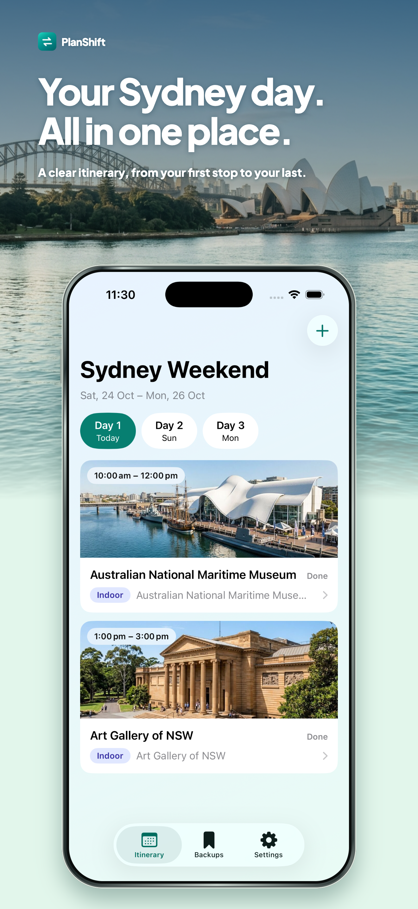
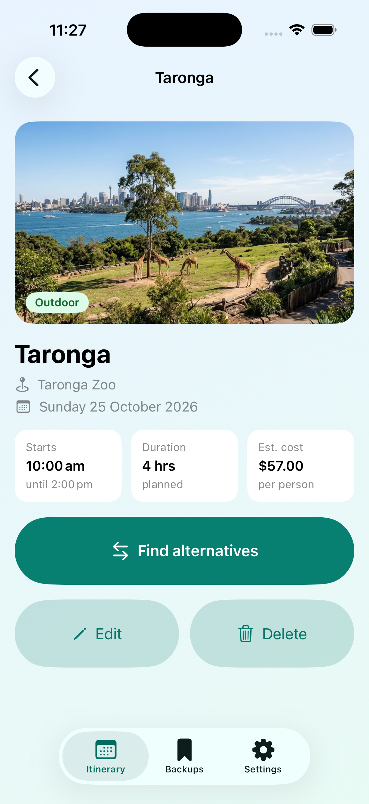
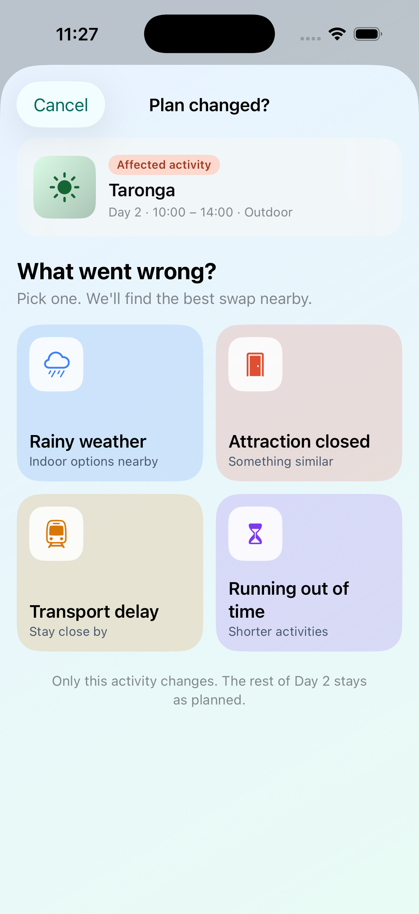
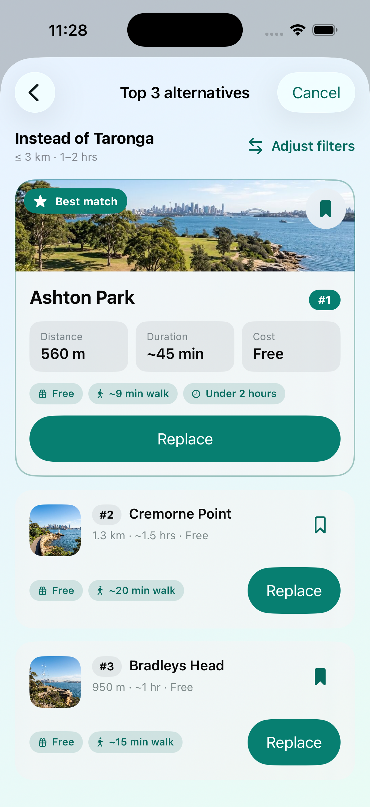
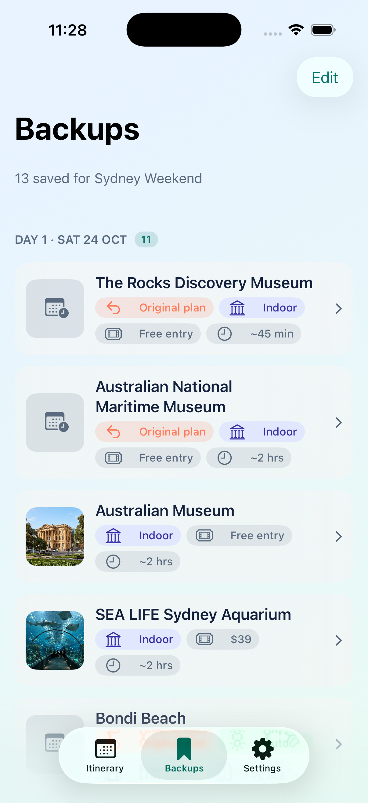
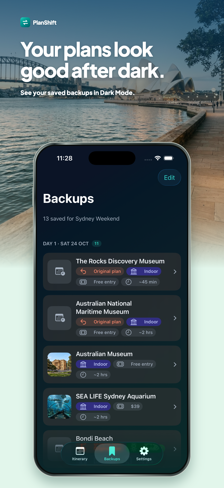
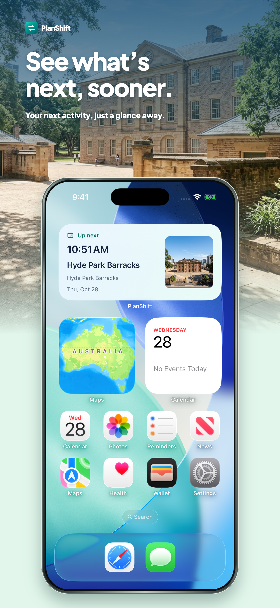

# PlanShift

**Backup plans when trips change.**

PlanShift helps independent travellers on short city trips in Sydney when a plan falls through, for example because of rain, a closed attraction, a transport delay or running out of time. The traveller picks the affected activity and what went wrong, adjusts a few quick filters, and gets the **top 3 ranked alternatives** with short reasons, with the option to see more. They can **replace** the activity in one tap, **undo** it, or **save an alternative as a backup** for later.

UTS 40005 Advanced iOS Applications, Assessment 4 (team of 5). iOS 17.6+, SwiftUI, Core Data, WidgetKit. No third-party packages.

---

## Screenshots

<p>
  
  
  
  
  
  
  
</p>

---

## Features

- **Itinerary (M1):** create a trip, then add, edit and delete activities day by day. Place search uses a bundled list of Sydney places and checks for overlapping times.
- **Recommendations (M2):** choose what went wrong, adjust budget, distance, duration and indoor or outdoor filters, and get the top 3 alternatives with distance, duration, cost and reasons. Tap **See more options** to see up to 8. Works offline, using 77 bundled Sydney places.
- **Replace (M3):** a before and after confirmation, an overlap check, and a "Plan updated" message with **Undo** that fades out after a few seconds.
- **Backups (M4):** saved alternatives grouped by trip day. When an activity is replaced, the original is kept automatically as an **Original plan** backup, and it can be restored later. Swipe left to delete.
- **Widget, location and settings (M5):** Home Screen and Lock Screen widgets show the next upcoming activity and open it through `planshift://`. Location is requested only when needed (When In Use), with an explanation first. If location is off, distances are measured from the planned activity. Settings include location status, default preferences, appearance and a privacy policy.
- **Accessibility:** Dark Mode, Dynamic Type, VoiceOver labels and touch targets of at least 44 × 44 pt.

---

## Architecture

MVVM with a Use Case layer and the Repository pattern.

```
 View (SwiftUI)              layout and user input only, no Core Data, no business rules
   │  calls methods  ▲ observes state
 ViewModel                   @Observable @MainActor, screen state, talks only to use cases
   │  execute(...)   ▲ domain models
 Use Case                    one business action per type, throws DomainError
   │                 ▲ domain models
 Repository protocol         Shared/Domain/Repositories (interfaces)
   │
 ├─ Core Data repository     real app, maps NSManagedObject ⇄ domain model
 └─ Mock repository          in-memory, used in previews and unit tests
   │
 Core Data store             SQLite in the App Group group.com.utsstudent.zhaoziying.planshift
                             (shared with the widget)
```

`RootView` creates the shared Core Data repositories once and injects them into every module, so the itinerary, recommendations, replace flow, backups and widget all read and update the same data. Navigation (tabs, sheets, the itinerary path and widget deep links) goes through `AppRouter`.

**Example: using a backup**
`UseBackupView` → `UseBackupViewModel` → `AppRouter` opens the replace confirmation → `ReplaceViewModel` → `ReplaceActivityUseCase` (overlap check, saves the original as a backup, updates the activity) → `CoreDataActivityRepository` and `CoreDataBackupRepository` → Core Data. The widget is then asked to reload.

**Storage**
- Trips, activities and backups: Core Data in the App Group.
- Appearance and default preferences: UserDefaults.
- Places: `Resources/places.json`, bundled with the app.

---

## Folder structure

```
PlanShift/
├── PlanShift/
│   ├── App/                      PlanShiftApp, RootView, CurrentTripView
│   ├── Features/
│   │   ├── M1_Itinerary/         Views, ViewModels, UseCases, Data
│   │   ├── M2_Recommendations/   Views, ViewModels, UseCases
│   │   ├── M3_Replace/           Views, ViewModels, UseCases
│   │   ├── M4_Backups/           Views, ViewModels, UseCases
│   │   └── M5_Settings/          Views, ViewModels, UseCases, Services, Widget
│   ├── Shared/
│   │   ├── Domain/               Models, Errors, Repositories (protocols), Services
│   │   ├── Data/                 Persistence, Repositories, Mappers, Mocks, Preferences
│   │   ├── DesignSystem/         AppColors
│   │   └── Navigation/           AppRouter
│   └── Resources/                places.json
├── PlanShiftWidget/              Next activity widget
├── PlanShiftTests/               Unit tests
└── PlanShiftUITests/             UI tests
```

---

## Team and module ownership

| Module | Area | Owner |
|---|---|---|
| Foundation | Project setup, shared domain models, repository protocols, App Group, URL scheme | Ziying Zhao |
| M1 | Itinerary | Qihao Lin |
| M2 | Recommendations | Van Dao Le |
| M3 | Replace | Chia-Ming Chang |
| M4 | Backups | Ziying Zhao |
| M5 | Widget, location and settings | Yu-Sheng (Sam) Chang |

---

## Git workflow

- **`main`:** the submitted version.
- **`develop`:** the integration branch.
- **Feature branches** from `develop`, for example `feat/m1-coredata`, `fix/restore-original-plan`, `feat/more-places`.
- **Pull requests** into `develop`, then `develop` is merged into `main` for release.
- **Conventional Commits:** `feat:`, `fix:`, `test:`, `docs:`, `refactor:`, `chore:`.

---

## Build and run

1. Open `PlanShift/PlanShift.xcodeproj` in Xcode.
2. Select the **PlanShift** scheme and an iPhone simulator (for example iPhone 17 Pro).
3. Press **Cmd+R** to run, or **Cmd+U** to run the tests.

Or from the command line:

```bash
xcodebuild -project PlanShift/PlanShift.xcodeproj -scheme PlanShift \
  -destination 'platform=iOS Simulator,name=iPhone 17 Pro' build
```

The app starts with no trip. Tap **Create your first trip**, then add activities. For realistic distances, set the simulator location to Circular Quay (Features → Location → Custom Location: -33.8611, 151.2109).

---

## Third-party packages

None.
